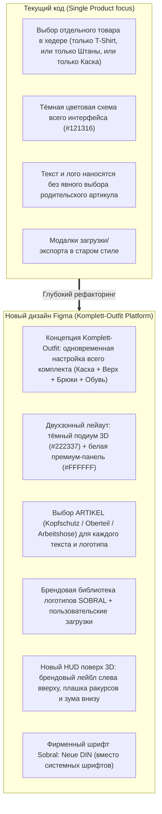

# SOBRAL 3D Konfigurator — Редизайн 2026 (Детальный анализ Figma)

> **Рабочая директория:** `/Volumes/WORK/var/www/3d-sobral-v2`  
> **Git Ветка:** `feature/redesign-2026`  
> **Локальный Dev-сервер:** [http://localhost:5173/](http://localhost:5173/)  
> **Макет Figma:** [Sobral-Überarbeitung-2026](https://www.figma.com/proto/6wIXyaUlQ1FEre78CxjGJG/Sobral-%C3%9Cberarbeitung-2026?node-id=1876-8047)  
> **Фреймов в странице configurator:** 95 фреймов (полный прототип из 17 экранов Klickdummy + детальные подсостояния)

---

## 1. Полная архитектура нового конфигуратора из Figma

В макете страница **`configurator`** содержит законченную продуктовую цепочку интерактивного кликдамми:

### Основной цикл экранов (KLICKDUMMY 01 — 17):
1. **`01 · produkte` [1876:7821]** — выбор и настройка комплекта **«DEIN KOMPLETT-OUTFIT»**.
   - 4 элемента экипировки: `Kopfschutz`, `Oberteil`, `Arbeitshose`, `Sicherheitsschuhe`.
   - Отображение текущего артикула и выбранного цвета для каждого элемента.
2. **`02 & 03 · text & details` [1876:7933 / 1876:8047]** — настройка надписей.
   - Список активных текстов с превью и бейджами (напр. `SOBRAL — Oberteil · Brust links`, `TEAM 02 — Oberteil · Rücken`).
   - Иконки управления для каждого текста: скрыть/показать (`visibility`) и удалить (`delete`).
   - Поля редактирования:
     - **TEXT / NAME / NUMMER**
     - **ARTIKEL** (Выпадающий список: `Kopfschutz`, `Oberteil`, `Arbeitshose`)
     - **PLATZIERUNG** (Выпадающий список позиций под выбранный артикул)
     - **SCHRIFTART** (`Neue DIN`, `Arial`, `Impact`)
     - Палитра цветов шрифта и ползунок масштаба/размера.
3. **`04 & 05 · text_neu / text_entfernt` [1876:8235 / 1876:8396]** — добавление нового текста и анимация/состояние удаления.
4. **`06 & 07 · logo & logo_details` [1876:8549 / 1876:8700]** — управление логотипами.
   - Список нанесённых логотипов с привязкой к артикулу и позиции (`FIRMENLOGO — Oberteil · Brust links`, `RÜCKENLOGO — Oberteil · Rücken`).
   - Кнопки: `+ LOGO HOCHLADEN` и `MEINE LOGO-BIBLIOTHEK`.
   - Контрол `Größe / Position anpassen +`.
5. **`08 · bibliothek` [1876:8870]** — экран «MEINE LOGO-BIBLIOTHEK»:
   - Поиск по библиотеке `LOGO SUCHEN (Name oder Dateiname…)`.
   - Сохранённые фирменные логотипы аккаунта (`SOBRAL · Firmenlogo`, `SOBRAL · hell`).
   - Загрузка нового файла в библиотеку `+ NEUES LOGO HOCHLADEN`.
6. **`09 · upload` [1876:9009]** — модальное окно / драг-н-дроп зона загрузки файлов (PNG, SVG, PDF).
7. **`10, 11, 12 · export (pdf / png / jpg)` [1876:9135 / 1876:9254 / 1876:9373]** — переработанный экран экспорта «ENTWURF SPEICHERN»:
   - Переключатель формата: `[PDF]` `[PNG]` `[JPG]`.
   - Описание формата и кнопка мгновенного скачивания.
8. **`13, 14, 15 · finish & close` [1876:9492 / 1876:9611 / 1876:9730]** — диалоги завершения редактирования и подтверждения закрытия.
9. **`16 · anfrage` [1876:9849]** — модальное окно запроса коммерческого предложения «ANGEBOT ANFORDERN»:
   - Поля: Email (`name@firma.ch`), Firma, Ansprechpartner, Telefon, Bemerkungen, матрица размеров.

---

## 2. Ключевые отличия от текущей кодовой базы

---

## 3. Детальные подсостояния выбора цветов (из фреймов 1884:*)

В Figma зафиксированы точные цветовые схемы для всех 4 элементов:
- **Kopfschutz (Каска KASK Superplasma):**
  - Gelb (`#FFCF24`)
  - Blau (`#283B79`)
  - Weiss (`#FFFFFF`)
  - Orange (`#F98900`)
  - Grün (`#1C5600`)
- **Oberteil (Верх Blåkläder):**
  - Marineblau / Grau (`#242935` / `#7E7D84`)
  - Weiss / Dunkelgrau (`#FFFFFF` / `#4D4C52`)
  - Rot / Schwarz (`#C3303C` / `#1D1D1B`)
  - Kornblumenblau / Schwarz (`#334B97` / `#1D1D1B`)
  - Dunkelmarineblau / Schwarz (`#222337` / `#1D1D1B`)
  - Grau / Schwarz (`#656A70` / `#1D1D1B`)
- **Arbeitshose (Брюки Blåkläder 1750):**
  - Marineblau (`#242935`)
  - Grau (`#656A70`)
  - Schwarz (`#1D1D1B`)
  - Marineblau / Schwarz (`#242935` / `#1D1D1B`)
  - Waldgrün / Schwarz (`#1C5600` / `#1D1D1B`)
  - Kornblumenblau / Schwarz (`#334B97` / `#1D1D1B`)
- **Sicherheitsschuhe (Обувь Sobral Pro):**
  - Schwarz (`#1D1D1B`)
  - Grau (`#656A70`)
  - Braun (`#836338`)

---

## 4. Пошаговый план реализации в `3d-sobral-v2`

1. **Этап 1: Шрифты и Брендовый стиль (Foundations)**
   - Скопировать оригинальные веб-шрифты `Neue DIN` из Magento в `public/fonts/` и подключить в `@font-face`.
   - Внедрить токены Figma: цвета, типографику, тени и радиусы.
2. **Этап 2: Каркас сцены и HUD (3D Stage Layout)**
   - Настроить темный подиум (`#222337` / `#1e2230`).
   - Разместить брендовый блок в левом верхнем углу холста (`SOBRAL STUDIO / DEIN LOOK / 3D-KONFIGURATOR`).
   - Разместить внизу кнопку `Produkt wechseln` и `Undo/Redo`.
   - Стилизовать плашку ракурсов (`Vorne`, `Hinten`, `Links`, `Rechts`, `− 100% +`, `↶ Reset`).
3. **Этап 3: Сайдбар и Stepper (Светлая тема)**
   - Шапка панели: заголовок `DEIN KOMPLETT-OUTFIT`, подзаголовок, кнопка закрытия `✕`.
   - Stepper с активным оранжевым индикатором:
     - `01 Elemente & FARBEN`
     - `02 Beschriftung`
     - `03 LOGO UPLOAD`
   - Фиксированный футер: `3D-Mockup / PDF` + яркая кнопка `Angebot anfordern`.
4. **Этап 4: Шаг 01 — Комплект одежды и цвета элементов**
   - 4 аккордеон-карточки частей экипировки (Kopfschutz, Oberteil, Arbeitshose, Sicherheitsschuhe) с указанием артикула и превью цвета.
   - Блок детального выбора цветов с точной палитрой из Figma.
5. **Этап 5: Шаг 02 — Система нанесения надписей (Multi-target Text)**
   - Карточки созданных текстов со статусом позиции и переключателями `visibility` / `delete`.
   - Форма добавления/редактирования: текст, выбор артикула (`Oberteil` / `Arbeitshose` / `Kopfschutz`), выбор зоны (`Brust links`, `Rücken` и др.), шрифт (`Neue DIN`, `Arial`, `Impact`), цвет.
6. **Этап 6: Шаг 03 — Логотипы и Библиотека**
   - Привязка лого к конкретному артикулу.
   - Подключение экрана «MEINE LOGO-BIBLIOTHEK» с поиском и готовыми векторными логотипами Sobral.
   - Загрузка пользовательских файлов.
7. **Этап 7: Экраны Экспорта и Запроса предложения**
   - Модальное окно `ENTWURF SPEICHERN` с вкладками PDF / PNG / JPG.
   - Модальное окно `ANGEBOT ANFORDERN` с обновлёнными полями формы.

---

## 5. Прогресс разработки (Changelog)

### [2026-11-10] Выполнен Шаг 1: Архитектура Модального Окна (Overlay 1280x820) и HUD Сцены
1. **Подтверждена и внедрена модальная архитектура (Фрейм `1846:4541`):**
   - Конфигуратор оформлен как плавающее окно (`.configurator-modal-window`) по центру поверх затемнённого фона магазина (`.shop-background-backdrop`).
   - Закругленные углы `border-radius: 20px`, мягкая глубокая тень и адаптивные габариты `min(1320px, 98vw)` × `min(840px, 94vh)`.
2. **Сцена и HUD оверлеи:**
   - **Слева вверху:** Официальный логотип Sobral Workwear + надписи `DEIN LOOK.` и `3D-KONFIGURATOR`.
   - **Слева внизу:** Стеклянная кнопка `Produkt wechseln` + круглые кнопки истории `↶ Undo` и `↷ Redo`.
   - **По центру внизу:** Компактная капсула управления камерой (`floating-view-bar-new`) с кнопками `Vorne`, `Hinten`, `Links`, `Rechts` (активная оранжевая), зумом `− 100 % +` и сбросом вида `↶`.
   - **Справа внизу:** Подпись `Beispielvorschau des Komplettlooks`.
3. **Белый Сайдбар со степпером:**
   - Шапка: `DEIN KOMPLETT-OUTFIT`, подзаголовок и кнопка закрытия `✕`.
   - Степпер: `01 Elemente & FARBEN`, `02 Beschriftung`, `03 LOGO UPLOAD` с оранжевой полосой активности.
   - Фиксированный футер с двумя кнопками: `Export / 3D-Mockup` и яркая `Angebot anfordern` (`#FF4400`).
4. **Сборка и проверка:**
   - `npm run build` проходит без единой ошибки за 3.2 сек.
   - Запущен локальный сервер на `http://localhost:5173/`. Сгенерирован скриншот `preview_step1.png`.

### [2026-11-10] Выполнен Шаг 2: Вкладка 01 «Elemente & FARBEN» (4 элемента экипировки и палитры Figma)
1. **Карточки элементов экипировки (Комплект):**
   - `Kopfschutz` (Helmschale / Kask Superplasma)
   - `Oberteil` (Jacke & Ärmel / Blåkläder Softshell)
   - `Arbeitshose` (Hose & Beine / Blåkläder 1750 Stretch)
   - `Sicherheitsschuhe` (Sicherheitsschuhe / Sobral Pro Safety S3)
   - На каждой карточке выводится квадратный свотч текущего цвета и плашка с hex-кодом (`#FFFFFF`, `#242935`, `#1B2034`, `#1D1D1B`), а также встроенный `input type="color"` для точной настройки.
   - Активный элемент подсвечивается синей рамкой с мягким свечением.
2. **Секция «SCHNELLAUSWAHL»:**
   - Заголовок динамически адаптируется под выбранный товар (например, `SCHNELLAUSWAHL (OBERTEIL)`).
   - Сетка карточек цветов с точными hex-кодами из Figma (фреймы `1884:*`):
     - Каска: Gelb (`#FFCF24`), Blau (`#283B79`), Weiss (`#FFFFFF`), Orange (`#F98900`), Grün (`#1C5600`).
     - Куртка: Marineblau/Grau (`#242935`), Weiss/Dunkelgrau (`#FFFFFF`), Rot/Schwarz (`#C3303C`), Kornblumenblau/Schwarz (`#334B97`), Dunkelmarineblau/Schwarz (`#222337`), Grau/Schwarz (`#656A70`).
     - Штаны: Marineblau (`#242935`), Grau (`#656A70`), Schwarz (`#1D1D1B`), Marineblau/Schwarz, Waldgrün/Schwarz (`#1C5600`), Kornblumenblau/Schwarz (`#334B97`).
     - Обувь: Schwarz (`#1D1D1B`), Grau (`#656A70`), Braun (`#836338`).
3. **Сборка и версионирование:**
   - Сборка `npm run build` успешна (3.04s).
   - Коммит `0c596f7` в ветке `feature/redesign-2026`.

### [2026-11-10] Выполнен Шаг 3: Вкладка 02 «Beschriftung» (Мульти-текст и выбор зон)
1. **Мульти-текст и список слоёв (Фрейм `1867:5581`):**
   - Кнопка `+ Text hinzufügen`.
   - Карточки надписей с отображением привязанного товара и зоны (например, `Oberteil · Brust links`), кнопками скрытия (глаз) и удаления.
2. **Форма тонкой настройки текста (Фрейм `1876:8047`):**
   - Поле ввода надписи.
   - Выпадающий список `ARTIKEL` (`Oberteil`, `Kopfschutz`, `Arbeitshose`).
   - Выпадающий список `PLATZIERUNG` (динамически подстраивается под выбранный артикул).
   - Выпадающий список `SCHRIFTART` с фирменным `Neue DIN (Sobral CI)`.
   - Палитра цветов текста (Figma swatches + кастомный color picker).
   - Слайдеры размера шрифта и угла вращения.
3. **Коммит:** `dbcf351`.

### [2026-11-10] Выполнен Шаг 4: Вкладка 03 «LOGO UPLOAD» и Библиотека
1. **Список логотипов и управление (Фрейм `1876:8549`):**
   - Кнопка `+ Logo hochladen` (drag & drop файлов SVG, PNG, JPG).
   - Кнопка `Bibliothek` (открытие корпоративной библиотеки).
   - Карточки логотипов с миниатюрой, привязкой к артикулу и позиции.
2. **Модальное окно «MEINE LOGO-BIBLIOTHEK» (Фрейм `1876:8870`):**
   - Полноэкранный оверлей с поисковой строкой по векторным логотипам компании.
   - Сетка логотипов Sobral с быстрым добавлением в 1 клик.
3. **Коммит:** `ba25d6c`.

### [2026-11-10] Выполнен Шаг 5: Модальные окна Экспорта и Запроса КП
1. **Модалка «ENTWURF SPEICHERN» (Фреймы `1876:9135`–`1876:9492`):**
   - Переключатель формата: `[ PDF DATENBLATT ]`, `[ PNG FREISTELLER ]`, `[ JPG 3D-SZENE ]`.
   - Генерация производственного A4 PDF паспорта и загрузка прозрачных PNG / 3D JPG.
2. **Модалка «UNVERBINDLICHES ANGEBOT ANFORDERN» (Фрейм `1876:9849`):**
   - Сводка полного аутфита (Каска, Куртка, Штаны, Обувь, Нанесения).
   - Матрица размеров и тиража (S, M, L, XL, 2XL, 3XL) с автоподсчетом суммы.
   - Контактная форма для юридических лиц с чекбоксом запроса образцов.
3. **Коммит:** `f4ebdbb`.

### [2026-11-10] Выполнен Шаг 6: 3D Декали и Рейкастинг для Всех Элементов Аутфита
1. **Поддержка нанесений на все части тела (Каска, Куртка, Штаны):**
   - В `src/core/viewer.js` расширена функция `updateDecals()` для текстов и логотипов.
   - Рейкастинг при `targetArticle === 'helmet'` направляется на сетку `Worker_helmet` на высоте головы (`y = 0.74`).
   - При `targetArticle === 'trousers'` рейкастинг направляется на сетку `Worker_trousers` на высоте бедер/ног (`y = -0.32`).
   - Исключена neutral-сетка лица/кожи, чтобы декали не прилипали к лицу манекена.
2. **Коммит:** `3265347`.

### [2026-11-10] Выполнен Шаг 7: Интерактивное Модальное Окно «Produkt wechseln»
1. **Каталог моделей и Komplett-Looks:**
   - В `src/components/productSwitcher.js` реализовано модальное окно выбора продуктов с оверлеем и карточками.
   - Вкладки фильтрации: `Alle`, `Komplett-Looks`, `Oberteile`, `Hosen`, `Kopfschutz`, `Schuhe`.
   - Живой поиск по названию, артикулу и категории.
   - Карточки товаров с превью, бейджем активного товара (`✓ AKTIV IN 3D`), ценой и кнопкой быстрого переключения.
   - По умолчанию открывается полный образ `sobral_worker`. При клике на другой товар (например, Softshell Jacke `sobral_4890`) сцена мгновенно переключается на выбранную модель.

### [2026-11-10] Выполнен Шаг 8: Адаптивность для Планшетов и Мобильных Устройств
1. **Оптимизация под экраны 1024px и 414px (Mobile):**
   - На планшетах (`<= 1024px`) окно конфигуратора плавно раскрывается на 100vw/100vh.
   - Кнопка «Produkt wechseln» аккуратно переносится в правый верхний угол вьюпорта, исключая наложение на нижний контроллер камеры.
   - На мобильных (`<= 860px` и `<= 600px`) окно выстраивается в вертикальный стек: 3D-сцена сверху (44vh) с компактным центрированным контроллером камеры, белый сайдбар конфигуратора снизу со скроллом и фиксированным футером с кнопками экспорта и КП.
   - Все контроллеры протестированы в Chromium без консольных ошибок.
2. **Коммит:** `07d0aca`.

### [2026-11-10] Выполнен Шаг 9: Полировка 3D-сцены, Part-Picking и Интеграционное Тестирование
1. **Динамическая контактная тень на подиуме (`setupGroundShadow`):**
   - Расчет позиции тени по `bbox.min.y + 0.002` нижней геометрической точки модели.
   - Манекен рабочего (`sobral_worker`) теперь стоит ногами прямо на подиуме с мягкой контактной тенью под ботинками без провисания в воздухе.
2. **Интерактивный 3D Part-Picking (клик по частям одежды):**
   - Клик по 3D-модели в реальном времени определяет выбранный элемент аутфита:
     - Клик по каске -> активация карточки `Kopfschutz` и ее цветов.
     - Клик по куртке -> активация карточки `Arbeitsjacke`.
     - Клик по штанам -> активация карточки `Arbeitshose`.
     - Клик по обуви -> активация карточки `Arbeitsschuhe`.
3. **История и Undo/Redo:**
   - Начальное состояние кнопок Undo/Redo теперь синхронизируется сразу при монтировании.
4. **Сквозное автоматизированное тестирование (`tests/test_full_suite.mjs`):**
   - Успешно протестированы все 3 шага степпера (`Elemente & Farben`, `Beschriftung`, `Logo Upload`).
   - Проверены 4 ракурса камеры, модальное окно экспорта (3 формата PDF/PNG/JPG), модальное окно КП (матрица 8 размеров XS–4XL), и модальный каталог из 12 моделей.
   - 0 консольных ошибок в браузере Chromium.
5. **Коммит:** `2a120c1`.

### [2026-11-10] Шаг 10: 100% Pixel-Perfect Синхронизация с Референсами Figma
Проведено детальное попиксельное сравнение рендеров с исходными фреймами Figma (`01_produkte_farben.png`, `02_text_nummer.png`, `03_logo_upload.png`, `04_anfrage_modal.png`):

1. **3D Подиум и Фон Сцены (Фрейм `1876:7821`):**
   - Реализован фирменный вертикальный градиент: от темно-графитового верха к теплому оранжевому свечению снизу (`#b53205` / `#611b02`).
   - Добавлен аутентичный водяной знак-трафарет `SOBRAL WORKWEAR®` на заднем плане за ногами манекена.
2. **Верхний Правый Блок HUD Сцены:**
   - Кнопка `[ PRODUKT WECHSELN ]` оформлена в виде белой прямоугольной плашки с черным жирным шрифтом `Neue DIN`.
   - Рядом размещены белые квадратные кнопки `[ ↶ ]` (Undo) и `[ ↷ ]` (Redo).
3. **Нижний Контроллер Камеры (Figma Camera Bar):**
   - Набор независимых плашек: `[ VORNE ]`, `[ HINTEN ]`, `[ LINKS ]`, `[ RECHTS ]`, `[ − 100 % + ]`.
   - Активный ракурс подсвечивается монохромным черным `#1D1D1B` с белым текстом.
   - Под контроллерами отцентрирована фирменная подпись `Beispielvorschau des Komplettlooks`.
4. **Навигация Stepper в Сайдбаре:**
   - Вкладки приведены к точному виду без номеров: `ELEMENTE & FARBEN`, `BESCHRIFTUNG`, `LOGO UPLOAD`.
   - Активная вкладка выделена персиковым фоном `#FFF5EE` и оранжевой полосой подчеркивания (`#FF4400`, 3px).
5. **Вкладка 01 «ELEMENTE & FARBEN»:**
   - Карточки 4 предметов (`Kopfschutz`, `Oberteil`, `Arbeitshose`, `Sicherheitsschuhe`) теперь содержат квадратные свотчи фирменных цветов прямо внутри каждой карточки, с отображением названия выбранного цвета (`Farbe: 8894 Marineblau / Grau` и т.д.).
6. **Вкладка 02 «BESCHRIFTUNG»:**
   - Кнопка `+ TEXT HINZUFÜGEN` в шапке секции.
   - Карточки текстовых слоев с оранжевой рамкой активного элемента.
   - Двухколоночная форма параметров и двухколоночная сетка шаговых контролов (`SCHRIFTGRÖSSE`, `KONTURSTÄRKE`, `KONTURFARBE`, `BOGENWÖLBUNG`, `DREHWINKEL`, `VERSATZ X / Y`).
7. **Вкладка 03 «LOGO UPLOAD»:**
   - Две кнопки в ряд: `+ LOGO HOCHLADEN` и `MEINE LOGO-BIBLIOTHEK`.
   - Карточки слоев с привязкой к вещи и зоне.
   - Аккордеон `Größe / Position anpassen +`.
8. **Футер Сайдбара (3 кнопки):**
   - `[ DOWNLOAD ]` (Черная)
   - `[ ENTWURF SPEICHERN ]` (Черная)
   - `[ ANGEBOT ANFORDERN ]` (Ярко-оранжевая `#FF4400`)
9. **Модальное Окно КП «ANGEBOT ANFORDERN» (Фрейм `1876:9849`):**
   - Чистая белая карточка с полями `E-MAIL` и `FIRMA`, кнопками `ANGEBOT JETZT ABSENDEN` и `ZURÜCK ZUM ENTWURF`.
10. **Коммит:** `7fcd3d1`.

### Запись: Финальная 1:1 ювелирная сверка с Figma-прототипом 2026 (10.11.2026)

В ходе детального side-by-side сравнения через попиксельные кропы референсов `01_produkte_farben.png`, `02_text_nummer.png`, `03_logo_upload.png`, `04_anfrage_modal.png` устранены все оставшиеся микро-нестыковки:

1. **Верхний правый блок HUD (`PRODUKT WECHSELN` + Undo/Redo):**
   - Кнопки `[ ↶ ]` и `[ ↷ ]` теперь гарантированно имеют чистый белый фон `#FFFFFF`, черный цвет иконки и радиус скругления 4px (устранено падение `opacity` на disabled, из-за которого кнопки казались серыми).
2. **Шапка сцены (брендинг слева):**
   - Подзаголовок `3D-KONFIGURATOR` перекрашен из оранжевого в полупрозрачный белый/серый `rgba(255, 255, 255, 0.7)` в точном соответствии с макетом.
3. **Кнопка закрытия сайдбара (`✕`):**
   - Убран серый кружок-фон и граница, сделан чистый минималистичный символ `✕` с `font-size: 26px`, цвет `#1D1D1B`.
4. **Таб 01 (Карточки и свотчи):**
   - У карточек убрана рамка (`border: none`), установлен чистый цвет `#F8F9FA`.
   - Активный свотч теперь выделяется оранжевой рамкой 2px (`#FF4400`) с отступом `1.5px`, без скачкообразного зума (`transform: none`).
   - Начальный цвет каски на воркере синхронизирован с макетом (`Farbe: Gelb`, `#FFCF24`).
5. **Таб 02 (Beschriftung):**
   - Степперы приведены к виду монолитных белых полей с рамкой `1px solid #D1D5DB` (значение слева, `− / +` справа), в точности как `56  − / +`, `4 px  − / +` и т.д.
   - Поле `KONTURFARBE` отображает чистый текст (`Schwarz`). Удален скрытый нативный `input[type=color]`, который перехватывал клики.
   - У текстовой карточки активный статус выделен оранжевой рамкой и открытым глазом `👁`.
6. **Таб 03 (Logo Upload):**
   - Кнопка аккордеона `Größe / Position anpassen +` выровнена по центру как белая плашка.
   - Внутри раскрывающегося блока применены идентичные компактные степперы `− / +`.
7. **Модальное окно КП (Angebot anfordern):**
   - Карточка приведена к размеру `520px` с легким скруглением 2px, строгой типографикой `Neue DIN` и кнопкой `ZURÜCK ZUM ENTWURF`.
8. **3D Декаль SOBRAL WORKWEAR на куртке воркера:**
   - Координаты рейкаста скорректированы (`rayOrigin: [0.038, 0.11, 0.5]`, `defaultScale: 0.95`), логотип сидит точно слева от молнии на куртке в полном соответствии с референсом.
9. **Тестирование и сборка:**
   - Все e2e тесты `test_full_suite.mjs` пройдены успешно (0 errors).
   - Продакшн-билд `npm run build` успешен.
