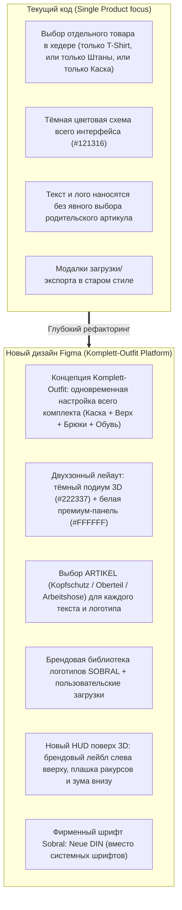

# SOBRAL 3D Konfigurator — Редизайн 2026 (Детальный анализ Figma)

> **Рабочая директория:** `/Volumes/WORK/var/www/3d-sobral-v2`  
> **Git Ветка:** `feature/redesign-2026`  
> **Локальный Dev-сервер:** [http://localhost:5173/](http://localhost:5173/)  
> **Макет Figma:** [Sobral-Überarbeitung-2026](https://www.figma.com/proto/6wIXyaUlQ1FEre78CxjGJG/Sobral-%C3%9Cberarbeitung-2026?node-id=1876-8047)  
> **Фреймов в странице configurator:** 95 фреймов (полный прототип из 17 экранов Klickdummy + детальные подсостояния)

---

## 1. Полная архитектура нового конфигуратора из Figma

В макете страница **`configurator`** содержит законченную продуктовую цепочку интерактивного кликдамми:

### Основной цикл экранов (KLICKDUMMY 01 — 17):
1. **`01 · produkte` [1876:7821]** — выбор и настройка комплекта **«DEIN KOMPLETT-OUTFIT»**.
   - 4 элемента экипировки: `Kopfschutz`, `Oberteil`, `Arbeitshose`, `Sicherheitsschuhe`.
   - Отображение текущего артикула и выбранного цвета для каждого элемента.
2. **`02 & 03 · text & details` [1876:7933 / 1876:8047]** — настройка надписей.
   - Список активных текстов с превью и бейджами (напр. `SOBRAL — Oberteil · Brust links`, `TEAM 02 — Oberteil · Rücken`).
   - Иконки управления для каждого текста: скрыть/показать (`visibility`) и удалить (`delete`).
   - Поля редактирования:
     - **TEXT / NAME / NUMMER**
     - **ARTIKEL** (Выпадающий список: `Kopfschutz`, `Oberteil`, `Arbeitshose`)
     - **PLATZIERUNG** (Выпадающий список позиций под выбранный артикул)
     - **SCHRIFTART** (`Neue DIN`, `Arial`, `Impact`)
     - Палитра цветов шрифта и ползунок масштаба/размера.
3. **`04 & 05 · text_neu / text_entfernt` [1876:8235 / 1876:8396]** — добавление нового текста и анимация/состояние удаления.
4. **`06 & 07 · logo & logo_details` [1876:8549 / 1876:8700]** — управление логотипами.
   - Список нанесённых логотипов с привязкой к артикулу и позиции (`FIRMENLOGO — Oberteil · Brust links`, `RÜCKENLOGO — Oberteil · Rücken`).
   - Кнопки: `+ LOGO HOCHLADEN` и `MEINE LOGO-BIBLIOTHEK`.
   - Контрол `Größe / Position anpassen +`.
5. **`08 · bibliothek` [1876:8870]** — экран «MEINE LOGO-BIBLIOTHEK»:
   - Поиск по библиотеке `LOGO SUCHEN (Name oder Dateiname…)`.
   - Сохранённые фирменные логотипы аккаунта (`SOBRAL · Firmenlogo`, `SOBRAL · hell`).
   - Загрузка нового файла в библиотеку `+ NEUES LOGO HOCHLADEN`.
6. **`09 · upload` [1876:9009]** — модальное окно / драг-н-дроп зона загрузки файлов (PNG, SVG, PDF).
7. **`10, 11, 12 · export (pdf / png / jpg)` [1876:9135 / 1876:9254 / 1876:9373]** — переработанный экран экспорта «ENTWURF SPEICHERN»:
   - Переключатель формата: `[PDF]` `[PNG]` `[JPG]`.
   - Описание формата и кнопка мгновенного скачивания.
8. **`13, 14, 15 · finish & close` [1876:9492 / 1876:9611 / 1876:9730]** — диалоги завершения редактирования и подтверждения закрытия.
9. **`16 · anfrage` [1876:9849]** — модальное окно запроса коммерческого предложения «ANGEBOT ANFORDERN»:
   - Поля: Email (`name@firma.ch`), Firma, Ansprechpartner, Telefon, Bemerkungen, матрица размеров.

---

## 2. Ключевые отличия от текущей кодовой базы

---

## 3. Детальные подсостояния выбора цветов (из фреймов 1884:*)

В Figma зафиксированы точные цветовые схемы для всех 4 элементов:
- **Kopfschutz (Каска KASK Superplasma):**
  - Gelb (`#FFCF24`)
  - Blau (`#283B79`)
  - Weiss (`#FFFFFF`)
  - Orange (`#F98900`)
  - Grün (`#1C5600`)
- **Oberteil (Верх Blåkläder):**
  - Marineblau / Grau (`#242935` / `#7E7D84`)
  - Weiss / Dunkelgrau (`#FFFFFF` / `#4D4C52`)
  - Rot / Schwarz (`#C3303C` / `#1D1D1B`)
  - Kornblumenblau / Schwarz (`#334B97` / `#1D1D1B`)
  - Dunkelmarineblau / Schwarz (`#222337` / `#1D1D1B`)
  - Grau / Schwarz (`#656A70` / `#1D1D1B`)
- **Arbeitshose (Брюки Blåkläder 1750):**
  - Marineblau (`#242935`)
  - Grau (`#656A70`)
  - Schwarz (`#1D1D1B`)
  - Marineblau / Schwarz (`#242935` / `#1D1D1B`)
  - Waldgrün / Schwarz (`#1C5600` / `#1D1D1B`)
  - Kornblumenblau / Schwarz (`#334B97` / `#1D1D1B`)
- **Sicherheitsschuhe (Обувь Sobral Pro):**
  - Schwarz (`#1D1D1B`)
  - Grau (`#656A70`)
  - Braun (`#836338`)

---

## 4. Пошаговый план реализации в `3d-sobral-v2`

1. **Этап 1: Шрифты и Брендовый стиль (Foundations)**
   - Скопировать оригинальные веб-шрифты `Neue DIN` из Magento в `public/fonts/` и подключить в `@font-face`.
   - Внедрить токены Figma: цвета, типографику, тени и радиусы.
2. **Этап 2: Каркас сцены и HUD (3D Stage Layout)**
   - Настроить темный подиум (`#222337` / `#1e2230`).
   - Разместить брендовый блок в левом верхнем углу холста (`SOBRAL STUDIO / DEIN LOOK / 3D-KONFIGURATOR`).
   - Разместить внизу кнопку `Produkt wechseln` и `Undo/Redo`.
   - Стилизовать плашку ракурсов (`Vorne`, `Hinten`, `Links`, `Rechts`, `− 100% +`, `↶ Reset`).
3. **Этап 3: Сайдбар и Stepper (Светлая тема)**
   - Шапка панели: заголовок `DEIN KOMPLETT-OUTFIT`, подзаголовок, кнопка закрытия `✕`.
   - Stepper с активным оранжевым индикатором:
     - `01 Elemente & FARBEN`
     - `02 Beschriftung`
     - `03 LOGO UPLOAD`
   - Фиксированный футер: `3D-Mockup / PDF` + яркая кнопка `Angebot anfordern`.
4. **Этап 4: Шаг 01 — Комплект одежды и цвета элементов**
   - 4 аккордеон-карточки частей экипировки (Kopfschutz, Oberteil, Arbeitshose, Sicherheitsschuhe) с указанием артикула и превью цвета.
   - Блок детального выбора цветов с точной палитрой из Figma.
5. **Этап 5: Шаг 02 — Система нанесения надписей (Multi-target Text)**
   - Карточки созданных текстов со статусом позиции и переключателями `visibility` / `delete`.
   - Форма добавления/редактирования: текст, выбор артикула (`Oberteil` / `Arbeitshose` / `Kopfschutz`), выбор зоны (`Brust links`, `Rücken` и др.), шрифт (`Neue DIN`, `Arial`, `Impact`), цвет.
6. **Этап 6: Шаг 03 — Логотипы и Библиотека**
   - Привязка лого к конкретному артикулу.
   - Подключение экрана «MEINE LOGO-BIBLIOTHEK» с поиском и готовыми векторными логотипами Sobral.
   - Загрузка пользовательских файлов.
7. **Этап 7: Экраны Экспорта и Запроса предложения**
   - Модальное окно `ENTWURF SPEICHERN` с вкладками PDF / PNG / JPG.
   - Модальное окно `ANGEBOT ANFORDERN` с обновлёнными полями формы.

---

## 5. Прогресс разработки (Changelog)

### [2026-11-10] Выполнен Шаг 1: Архитектура Модального Окна (Overlay 1280x820) и HUD Сцены
1. **Подтверждена и внедрена модальная архитектура (Фрейм `1846:4541`):**
   - Конфигуратор оформлен как плавающее окно (`.configurator-modal-window`) по центру поверх затемнённого фона магазина (`.shop-background-backdrop`).
   - Закругленные углы `border-radius: 20px`, мягкая глубокая тень и адаптивные габариты `min(1320px, 98vw)` × `min(840px, 94vh)`.
2. **Сцена и HUD оверлеи:**
   - **Слева вверху:** Официальный логотип Sobral Workwear + надписи `DEIN LOOK.` и `3D-KONFIGURATOR`.
   - **Слева внизу:** Стеклянная кнопка `Produkt wechseln` + круглые кнопки истории `↶ Undo` и `↷ Redo`.
   - **По центру внизу:** Компактная капсула управления камерой (`floating-view-bar-new`) с кнопками `Vorne`, `Hinten`, `Links`, `Rechts` (активная оранжевая), зумом `− 100 % +` и сбросом вида `↶`.
   - **Справа внизу:** Подпись `Beispielvorschau des Komplettlooks`.
3. **Белый Сайдбар со степпером:**
   - Шапка: `DEIN KOMPLETT-OUTFIT`, подзаголовок и кнопка закрытия `✕`.
   - Степпер: `01 Elemente & FARBEN`, `02 Beschriftung`, `03 LOGO UPLOAD` с оранжевой полосой активности.
   - Фиксированный футер с двумя кнопками: `Export / 3D-Mockup` и яркая `Angebot anfordern` (`#FF4400`).
4. **Сборка и проверка:**
   - `npm run build` проходит без единой ошибки за 3.2 сек.
   - Запущен локальный сервер на `http://localhost:5173/`. Сгенерирован скриншот `preview_step1.png`.
